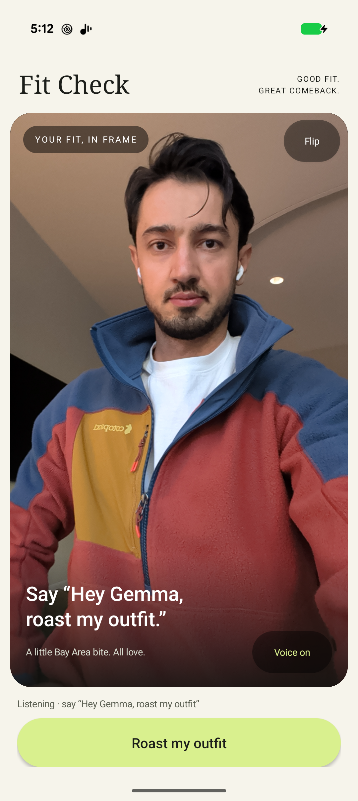

# Fit Check

**Your outfit. A roast. A better idea.**

An Android outfit roast and styling companion built with **Gemma 4 E2B +
LiteRT-LM** for the Google Gemma Hardware Hackathon, Mobile AI track.
Camera, audio, model inference and spoken replies run on the phone.
The application has **no Internet permission**.

[Read the five-slide pitch](output/pdf/fit-check-pitch.pdf) ·
[Submission summary](submission/pitch.md) ·
[Progress and known limitations](docs/milestone-progress.md)



*Earlier development screenshot. The current interface has been simplified.*

## Try the flow

1. Frame an outfit with either camera.
2. Say **“Hey Gemma, roast my outfit”**, or tap **Roast my outfit**.
3. Hear a short verdict and two jokes about visible clothing.
4. Ask **“Hey Gemma, how would you make it better?”**, or tap **Make it better**,
   for styling advice grounded in the original photo.

The style is editable in `android/app/src/main/java/dev/local/outfitroast/RoastStyle.kt`.

## A real response

> This ensemble screams 'I just woke up like this' with a palette that suggests a failed attempt at coordinated effort.
> The blue and orange jacket looks like it was designed by a committee that couldn't agree on a primary color.
> That white shirt is clearly trying too hard to be the neutral anchor in this aggressively colored disaster.

Unedited output from a saved replay of the pictured outfit; screenshot and response
are separate captures. This is a selected sample; accuracy and humor vary.

## What is implemented

- CameraX preview and capture, front/rear switching.
- Gemma image understanding, local audio transcription, structured roast/advice output.
- Offline Android text-to-speech and captions.
- One original-photo context for follow-up; no-outfit retake requests.
- Foreground voice capture, explicit wake gate, and visible demo buttons.
- Repeatable real-device evaluations and 46 passing JVM tests in the development build.

**Draft limitations:** live wake recognition remains inconsistent. Buttons are the
reliable demo trigger. Clothing identification and comic specificity need work.
Measured saved-photo inference was 7.3 and 13.8 seconds in two final runs; this
excludes microphone transcription, capture and speech and is not a latency guarantee.
Debug builds retain local diagnostic images/audio; deletion controls are unfinished.

## Build

Use Android Studio or JDK 17+, Android SDK 35, and an arm64 Android 12+ device.
The development device was a Pixel 11 Pro. Set `ANDROID_HOME` and `JAVA_HOME`
for your system; on Linux, explicitly point `ANDROID_HOME` to your Android SDK.

```bash
bash scripts/build.sh assembleDebug testDebugUnitTest lintDebug
bash scripts/device.sh install
```

Download **Gemma 4 E2B IT in LiteRT-LM format** from the official
[model resources](https://developers.google.com/edge/litert-lm/models/gemma-4).
Accept the model's terms through its official provider. Weights are not included
and are governed by their own terms. This build expects a specific 2,588,147,712-byte
bundle with SHA-256:

```text
181938105e0eefd105961417e8da75903eacda102c4fce9ce90f50b97139a63c
```

Enable USB debugging and authorize ADB, then provision the matching model:

```bash
bash scripts/device.sh model /absolute/path/gemma-4-E2B-it.litertlm
bash scripts/device.sh start
```

First-time dependency/model downloads require Internet on the development machine;
the installed app performs inference offline. Enable an offline English TTS voice
on the phone. Provisioning uses `run-as` and therefore requires the debug APK.

## Why Best Use of LiteRT

LiteRT-LM powers the app's image understanding, audio transcription and language
generation on the Pixel, with offline Android speech completing the interaction.
We profiled the actual device and tested vision backends, context sizes, visual
token budgets and multi-token prediction. The selected prepared contexts and
140-token image budget reduced two saved-photo measurements from 12.6/21.8 seconds
to 7.3/13.8 seconds. These small-sample timings exclude capture and speech;
prewarming moves work to startup/playback and fewer visual tokens trade detail
for speed. The award case is a working multimodal experience plus documented,
reproducible LiteRT engineering. [Full award pitch](submission/pitch.md#why-fit-check-deserves-best-use-of-litert).

## Architecture

CameraX / microphone → Gemma 4 E2B via LiteRT-LM 0.18.1 → validated JSON
→ offline Android TTS. GPU language generation; CPU vision/audio encoders.
140 visual tokens and fresh prepared system contexts reduce request latency.
No cloud inference, API key or server is required.

Source lives under `android/`; test helpers under `scripts/`. Existing evaluation
docs describe paths in the original hackathon workspace; in this standalone repo,
run commands relative to the repository root. Private recordings, model weights,
developer caches and the unrelated poker prototype are excluded.

## Pitch assets

The PDF source is `submission/build_pitch.py` (`pip install reportlab`). The screenshot
and selected response are deliberately included submission assets; other private
evaluation media is excluded. Run `python3 submission/build_pitch.py` to rebuild.
